# Архитектура компилятора Gon&On

## Пайплайн

Стадии собраны в одном месте — `ru.itmo.applang.compiler.Compiler.compile()`.
Его используют и CLI, и тесты, поэтому порядок стадий и обработка ошибок
везде одинаковы.

```
исходный .al файл (UTF-8)
      │
      ▼
┌─────────────────┐   ANTLR4-сгенерированные AppLangLexer/AppLangParser
│  Lexer + Parser  │   (src/main/antlr/.../AppLang.g4)
└─────────────────┘
      │  ParseTree (или SYNTAX_ERROR — стоп)
      ▼
┌─────────────────┐
│   AstBuilder     │   ru.itmo.applang.ast.AstBuilder — Visitor над ParseTree
└─────────────────┘
      │  AST (Program, FunctionDecl, Stmt, Expr — ru.itmo.applang.ast.Ast)
      ▼
┌─────────────────┐
│   TypeChecker    │   ru.itmo.applang.semantic.TypeChecker
│                  │   резолв имён (SymbolTable, ClassInfo), проверка типов, Unit
│                  │   только как оператор, литералы libstr, точка входа main,
│                  │   заполненность полей и this в конструкторе, пределы;
│                  │   заполняет resolvedType, слоты и разрешённые члены
└─────────────────┘
      │  типизированный AST (или диагностики об ошибках — стоп)
      ▼
┌─────────────────┐
│ BytecodeEmitter  │   ru.itmo.applang.codegen.BytecodeEmitter
│                  │   обход AST -> List<Instruction> на функцию; без классов —
│                  │   профиль 1.0, с классами — 2.0 (ClassTable, методы, init);
│                  │   InstructionBuffer (codegen/Labels.kt) резолвит метки if/while
│                  │   в byte-offset'ы, ConstantPoolBuilder дедуплицирует константы
└─────────────────┘
      │  BytecodeModule (ru.itmo.applang.bytecode)  — или LIMIT_EXCEEDED
      ▼
┌──────────────────────────────────────────────────────────────┐
│ BytecodeWriter.writeToBytes                                   │
│   1. BytecodeVerifier.verify(module)  — правила верификатора GVM │
│   2. serialize(module)                — байты .albc              │
│   3. BytecodeReader.readFromBytes     — строгое чтение байтов,   │
│      результат обязан совпасть с module                          │
└──────────────────────────────────────────────────────────────┘
      │  проверенные байты (или INTERNAL_COMPILER_ERROR — стоп)
      ▼
┌──────────────────────────┐        ┌─────────────────┐
│ BytecodeWriter.writeToFile│        │  Disassembler    │
│ атомарно -> файл .albc    │        │ -> текстовый дамп│
└──────────────────────────┘        └─────────────────┘
```

### Ошибки и выходной файл

| Где обнаружено | Диагностика | Что это значит |
|---|---|---|
| Lexer / Parser | `SYNTAX_ERROR` | ошибка исходника |
| TypeChecker | коды `SemanticErrorCodes` | ошибка исходника или превышение предела |
| BytecodeEmitter | `LIMIT_EXCEEDED` без позиции | программа корректна, но не помещается в формат (пул констант > 65535) |
| BytecodeWriter / Verifier / Reader | `INTERNAL_COMPILER_ERROR` без позиции | генератор построил байткод, нарушающий контракт GVM, — дефект компилятора |

При любой ошибке компиляция возвращает `CompilationResult.Failure`: CLI
печатает диагностики в stderr, завершается с кодом 1 и **не трогает**
выходной файл. Запись идёт во временный файл рядом с целевым и переносится
на его место атомарно, поэтому существующий `.albc` не заменяется ни
невалидными, ни частично записанными данными. «Скомпилировано» печатается
только после успешной записи.

Диагностика уровня программы (нет `main`, переполнение пула, внутренняя
ошибка) не имеет позиции в исходнике: `Diagnostic.position == null`.

### Проверка байткода

`BytecodeVerifier` повторяет правила верификатора GVM (описаны в
`docs/BYTECODE_SPEC.md` §7): структура и индексы, цели переходов только на
начало инструкции, режимы возврата VALUE/VOID/NONE, высоты операндного стека
по графу управления. Отдельный этап нужен потому, что типизация AST не
гарантирует отсутствие ошибок в генераторе, разрешении меток и
сериализации.

`BytecodeReader` — строгий reference-reader формата. Он не используется для
исполнения, но проверяет реальные байты: писатель прогоняет через него каждый
результат, тесты читают им выходные файлы. Оба компонента сообщают о
нарушении одним исключением `BytecodeFormatException` с категорией
`BytecodeIssue`, названия которых совпадают с категориями верификатора GVM.

`--disasm` печатает дамп **модели в памяти** (`Disassembler` над
`BytecodeModule`). Поскольку модель прошла round-trip через строгий reader,
дамп совпадает с тем, что прочитается из файла, но сам по себе он не
заменяет проверку байтов.

### Классы: от исходника к профилю 2.0

```mermaid
flowchart LR
    C["class Counter { val value: Int; constructor(...); fun get() }"] --> TC
    TC["TypeChecker&#10;ClassInfo: поля с номерами, методы, параметры конструктора&#10;InitState: заполненность полей в init"] --> E
    E["BytecodeEmitter&#10;таблица функций по исходнику:&#10;Counter.init, Counter.get, main"] --> M
    M["BytecodeModule 2.0&#10;ClassTable + ALLOC_OBJECT / GET_FIELD / SET_FIELD"]
```



- **Таблица функций** строится в порядке объявлений: функция верхнего
  уровня — одна запись; класс — функция инициализации `Класс.init`, затем
  методы `Класс.метод`. Метод и `init` получают неявный `this` в слоте 0.
- **Функция инициализации** — инициализаторы полей в порядке объявления, затем
  тело конструктора, затем `RETURN_VOID`. В ClassTable она не входит: её
  индекс пишется прямо в `CALL` выражения создания.
- **Временные слоты.** Получатель метода и создаваемый объект хранятся в
  скрытых локальных слотах. TypeChecker назначает каждому такому выражению
  глубину вложенности (`resolvedTempDepth`), функция получает
  `resolvedTempBase` — первый слот после именованных переменных; слот
  выражения — `resolvedTempBase + глубина`. Слоты одной глубины
  переиспользуются последовательными выражениями, вложенные выражения
  получают более глубокие слоты, поэтому живая ссылка не затирается.
- **Пул констант 2.0** начинается с метаданных: имена классов и их полей,
  затем имена функций в порядке таблицы, затем константы кода. Профиль 1.0
  сохраняет прежний порядок, поэтому байты процедурных программ не изменились.
- **Заполненность полей** проверяется консервативным анализом в
  `TypeChecker` (`InitState`: «гарантированно заполнено» и «возможно
  записано»), см. `docs/LANGUAGE_SPEC.md` §7.6.

## Пакеты

| Пакет | Ответственность |
|---|---|
| `ru.itmo.applang.parser` | ANTLR-сгенерированный код (не редактируется вручную) |
| `ru.itmo.applang.ast` | AST-узлы и построение AST из ParseTree |
| `ru.itmo.applang.semantic` | таблицы символов (функции, локальные переменные, классы `ClassInfo`), проверка типов, коды семантических ошибок |
| `ru.itmo.applang.codegen` | генерация байткода из типизированного AST |
| `ru.itmo.applang.bytecode` | модель байткода, опкоды, пределы формата (`FormatLimits`), контракт строк (`StringConstraints`), сериализация, строгое чтение, проверка (`BytecodeVerifier`), дизассемблер |
| `ru.itmo.applang.compiler` | фасад пайплайна `Compiler` и результат `CompilationResult` |
| `ru.itmo.applang.diagnostics` | единый формат диагностик для всех стадий |
| `ru.itmo.applang.cli` | точка входа `applangc` (`run()` возвращает код завершения, `main()` вызывает `exitProcess`) |

## Точки расширения для будущих версий языка

- Новые узлы AST добавляются как новые подтипы `sealed class Stmt`/`Expr`
  (`ast/Ast.kt`) — существующие узлы не меняются.
- Новые опкоды добавляются в `Opcode.kt` начиная с `0x40` (см.
  `docs/BYTECODE_SPEC.md` §3) — существующие коды не переиспользуются. Длина
  инструкции задаётся только `Opcode.operandBytes`; reader, writer, метки и
  верификатор берут её оттуда. Новый опкод нужно добавить и в таблицу
  эффектов стека `BytecodeVerifier`.
- Новые семантические проверки — новые ветки в `TypeChecker` + новые коды
  в `SemanticErrorCodes`.
- Новые пределы формата — только в `FormatLimits`, без локальных копий.
