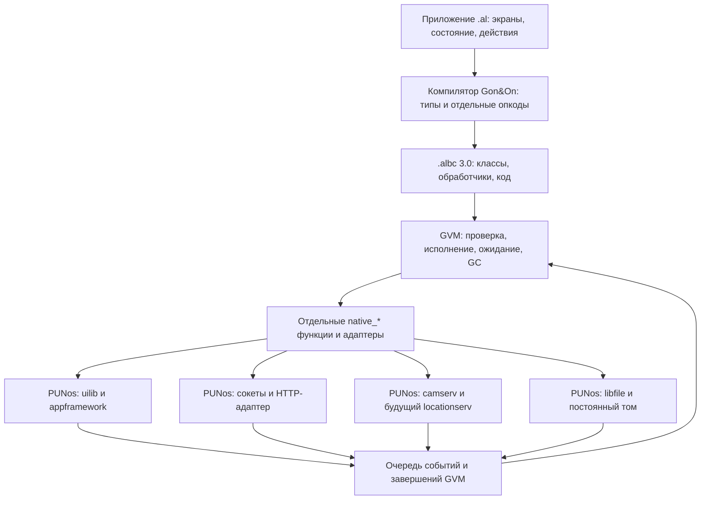

# Контракт Gon&On — GVM — PUNos: отдельная инструкция на каждый вызов

Дата проверки исходников: **18 ноября 2026 года**. Статус: **проект контракта
для согласования трёх команд**. Предлагаемый профиль — `.albc` **3.0**.
В Gon&On реализованы типизация, генерация, чтение, запись и проверка профиля
3.0 по этому документу. Реализация C-функций, ожидания, ресурсов и доставки
событий в GVM и адаптеров PUNos остаётся задачей соответствующих репозиториев.
Статус draft относится к согласованию общего ABI, а не к отсутствию компилятора.

## 1. Область действия и проверенная база

Контракт фиксирует один способ взаимодействия: каждому платформенному вызову
Gon&On соответствуют **собственная инструкция байткода и отдельная C-функция
в GVM**. Например, `capturePhoto()` → `CAPTURE_PHOTO` →
`native_capture_photo()` → IPC-запрос к `camserv` PUNos.
Таблица импортов и инструкция `CALL_HOST` в этот профиль не входят.

Сигнатуры всех 21 операций взяты из [`platform-api.json`](../platform-api.json)
без изменений. Каталог описывает язык; этот документ дополнительно определяет
байты, порядок аргументов, результаты, события и обязанности команд.
Числа новых опкодов, устройство встроенных классов, сетевой протокол,
формат загрузки фото и значения лимитов ниже — **новые проектные решения**,
а не утверждения о существующей реализации или уже достигнутом согласовании.

Проверены исходники веток `main` организации [ITMOdefence](https://github.com/ITMOdefence):

| Репозиторий | Проверенная ревизия | Основа контракта |
|---|---|---|
| [Gon-On](https://github.com/ITMOdefence/Gon-On/tree/8dc01c9f0b1141dfbd6b25bf886d15bdeeb31fe5) | `8dc01c9f0b1141dfbd6b25bf886d15bdeeb31fe5` | Компилятор, форматы 1.0/2.0, каталог платформенных функций; учтены также локальные изменения документации. |
| [GVM](https://github.com/ITMOdefence/GVM/tree/1ffa2389388c6f9bbcae9e253f787df3e444afaa) | `1ffa2389388c6f9bbcae9e253f787df3e444afaa` | Загрузчик, верификатор, интерпретатор, `NativeRuntime`, обработчики и мост к `appframework`. |
| [PUNos](https://github.com/ITMOdefence/PUNos/tree/eb6f870439147e2fbd73378f81ff4ea6bd7d6f5c) | `eb6f870439147e2fbd73378f81ff4ea6bd7d6f5c` | `uilib`, `appframework`, `camserv`, сокеты, `libfile`, `libstr`, реестр сервисов и сборка образа. |

Состояние определялось по коду и конфигурации, а не только по README:
README GVM ещё описывает незавершённый Core, хотя в исходниках есть
планировщик и CLI; README PUNos называет UI спецификацией, хотя реализация
`uilib` и GUI-сервисов уже присутствует. Наличие кода не означает, что вся
цепочка из трёх проектов проверена в QEMU.

| Область | Что есть в проверенной базе | Чего пока нет на стыке |
|---|---|---|
| Gon&On | В проверенном SHA — 1.0/2.0 и каталог; локальная реализация добавляет 3.0, встроенные типы, отдельные инструкции и EventTable. | Внешний запуск на GVM/PUNos 3.0. |
| GVM | `vm_register_handler`, `vm_dispatch_handler`; `native_print`, `native_complete`, ожидание и отмена операций. | 21 платформенная функция, привязка `AppState` из файла и реестр платформенных ресурсов. |
| UI | `ui_view_create`, буферы, present и события touch/pointer/key. GUI-сервисы включены в реестре. | Виджеты кнопок и полей, отрисовка текста/ресурсов и перевод координат ввода в ID кнопки. |
| Камера | `camlib`, `camserv`, сообщения `CAM_SUBSCRIBE`/`CAM_FRAME`. | Адаптер одного снимка; камера гостевой ОС и конфигурация сервиса. `camserv` по умолчанию отключён. |
| Координаты | Файл `DevDoc/SystemServices/abilities/locationserv.md` содержит шаблон. | Рабочий источник координат, сервис и его IPC-протокол. |
| Сеть | Обёртки `socket`, `bind`, `listen`, `accept`, `connect`, `send`, `recv`, `getsockopt`. | Текстовые сообщения поверх TCP, HTTP-клиент загрузки фото и интеграция с GVM. |
| Файлы | `libfile`: чтение, запись, flush и rename. | Каталог конкретного приложения на постоянном томе. Штатный запуск использует initramfs. |

Отдельное ограничение сборки: `GVM/Makefile` закрепляет PUNos на
`125ad13ce84256e09d8f2331bf4e9229bb3711dd`, а не на проверенном здесь
`eb6f870…`. Перед интеграцией команда GVM должна явно обновить закреплённую
ревизию и проверить ABI; автоматическая совместимость этих снимков не предполагается.

## 2. Архитектура и ответственность



- **Gon&On** проверяет имена, число и типы аргументов, запрещает подделку
  встроенных типов, генерирует инструкции и описания обработчиков.
- **GVM** проверяет файл до исполнения, снимает аргументы со стека, вызывает
  соответствующую C-функцию, управляет ожиданием, объектами результатов и GC.
- **Адаптеры платформы** переводят значения GVM в интерфейсы PUNos:
  рисуют виджеты, собирают TCP-сообщения, удерживают снимок, читают файлы.
  Эти адаптеры нужно реализовать; их имена ниже — предлагаемые точки расширения.
- **PUNos** предоставляет реальные устройства, сервисы, файловые системы
  и цикл событий. Схема группы, код приглашения, содержимое сообщений,
  преобразование географических координат в точку карты и адрес сервера
  распознавания остаются логикой приложения.

## 3. Профиль байткода 3.0

### 3.1. Совместимость и раскладка

Действующий [контракт 1.0/2.0](backlog/bytecode-contract.md) сохраняется.
Процедурные программы продолжают компилироваться в 1.0, обычные объектные —
в 2.0. Наличие платформенного вызова, `bindAppState` или обработчика платформы
требует 3.0. Профиль 3.0 включает объектную модель 2.0.

```text
1.0: Header → ConstantPool → FunctionTable → CodeSection → EOF
2.0: Header → ConstantPool → FunctionTable → ClassTable → CodeSection → EOF
3.0: Header → ConstantPool → FunctionTable → ClassTable → EventTable → CodeSection → EOF
```

Заголовок остаётся 12-байтовым: `ALBC`, `version_major:u16 = 3`,
`version_minor:u16 = 0`, `flags:u16 = 0`, `entry_function_idx:u16`.
Все многобайтовые поля файла — **big-endian**, без padding.
Пулы, 12-байтовые записи функций и записи классов имеют раскладку 2.0.
`code_offset` по-прежнему отсчитывается от `code_bytes`, не от начала файла.

В 1.0/2.0 секции `EventTable` нет. Старые файлы не дополняются пустыми
секциями. Неизвестная версия, неназначенный опкод, лишний хвост или
усечённый операнд — отказ до исполнения. Инструкции `0x01–0x19` и
`0x40–0x42` сохраняют значения и поведение с расширениями для встроенных
классов, действующими только в 3.0 (§4).
185-байтовый эталон `Counter` профиля 2.0 должен остаться побайтно прежним.

В Gon&On `BytecodeModule.isObjectProfile` учитывает 2.0 и 3.0. Проверенная
внешняя GVM сравнивает major объектных инструкций именно с `2`: при её
обновлении недостаточно добавить `3` в список версий, нужно разрешить
объектные секции и инструкции для обоих профилей во всех слоях.

### 3.2. Новые инструкции

Числа `0x50–0x65` назначены в `Opcode.kt` компилятора по этому контракту.
В проверенной внешней GVM они пока не назначены; согласование ABI сохраняется.
Диапазоны `0x1A–0x3F`, `0x43–0x4F`, `0x66–0xFF` этим документом не назначаются.

**Все новые инструкции однобайтовые, без операндов в потоке кода.**
Аргументы передаются через стек, тип результата определяется опкодом.
Нет индекса импорта, имени C-функции или указателя, записанного в `.albc`.

| Код | Инструкция | Сигнатура Gon&On | Отдельная C-функция GVM | Стек: снять → положить |
|---|---|---|---|---|
| `0x50` | `OPEN_WINDOW` | `openWindow(title: String): WindowResult` | `native_open_window` | 1 → 1 |
| `0x51` | `SET_TEXT` | `setText(window: WindowRef, text: String): Status` | `native_set_text` | 2 → 1 |
| `0x52` | `ADD_BUTTON` | `addButton(window: WindowRef, id: Int, label: String): Status` | `native_add_button` | 3 → 1 |
| `0x53` | `ADD_TEXT_INPUT` | `addTextInput(window: WindowRef, id: Int): Status` | `native_add_text_input` | 2 → 1 |
| `0x54` | `GET_TEXT` | `getText(window: WindowRef, id: Int): TextResult` | `native_get_text` | 2 → 1 |
| `0x55` | `DRAW_IMAGE` | `drawImage(window: WindowRef, asset: String): Status` | `native_draw_image` | 2 → 1 |
| `0x56` | `DRAW_MARKER` | `drawMarker(window: WindowRef, x: Int, y: Int): Status` | `native_draw_marker` | 3 → 1 |
| `0x57` | `LISTEN` | `listen(port: Int): ListenerResult` | `native_listen` | 1 → 1 |
| `0x58` | `CONNECT` | `connect(address: String, port: Int): ConnectionResult` | `native_connect` | 2 → 1 |
| `0x59` | `SEND_TEXT` | `sendText(connection: ConnectionRef, text: String): Status` | `native_send_text` | 2 → 1 |
| `0x5A` | `CLOSE_CONNECTION` | `closeConnection(connection: ConnectionRef): Status` | `native_close_connection` | 1 → 1 |
| `0x5B` | `CLOSE_LISTENER` | `closeListener(listener: ListenerRef): Status` | `native_close_listener` | 1 → 1 |
| `0x5C` | `CAPTURE_PHOTO` | `capturePhoto(): PhotoResult` | `native_capture_photo` | 0 → 1 |
| `0x5D` | `UPLOAD_PHOTO` | `uploadPhoto(url: String, photo: PhotoRef): TextResult` | `native_upload_photo` | 2 → 1 |
| `0x5E` | `GET_DEVICE_LOCATION` | `getDeviceLocation(): LocationResult` | `native_get_device_location` | 0 → 1 |
| `0x5F` | `RELEASE_PHOTO` | `releasePhoto(photo: PhotoRef): Status` | `native_release_photo` | 1 → 1 |
| `0x60` | `READ_TEXT` | `readText(name: String): TextResult` | `native_read_text` | 1 → 1 |
| `0x61` | `WRITE_TEXT` | `writeText(name: String, text: String): Status` | `native_write_text` | 2 → 1 |
| `0x62` | `FORMAT_INT` | `formatInt(value: Int): String` | `native_format_int` | 1 → 1 |
| `0x63` | `PARSE_INT` | `parseInt(text: String): IntResult` | `native_parse_int` | 1 → 1 |
| `0x64` | `GET_TEXT_FIELD` | `getField(text: String, separator: String, index: Int): TextResult` | `native_get_text_field` | 3 → 1 |
| `0x65` | `BIND_APP_STATE` | `bindAppState(state: AppState): Unit` | `native_bind_app_state` | 1 → 0 |

Последняя операция служебная и не добавляется к 21 функции каталога.
Имя `GET_TEXT_FIELD` отличает разбор строки от существующего `GET_FIELD`
(`0x41`), читающего поле объекта.

Добавление новой операции требует синхронного изменения каталога,
таблицы опкодов, emitter/reader/writer/verifier/disassembler Gon&On,
loader/verifier/interpreter и отдельной C-функции GVM, документации и fixtures.
Неизвестная инструкция не подменяется `POP`, `NOP` или обычным `CALL`.

## 4. Типы данных и представление в GVM

`Int` — знаковое 32-битное число; `Bool` — логическое значение;
`String` — корректный UTF-8 без NUL, не более **1 048 576 байт**.
Последнее ограничение распространяется на входящие сообщения, содержимое
файлов, HTTP-ответ и результаты строковых операций.
Бинарные снимки через `String` не передаются; тип `Bytes` языку для этих
операций не требуется.

Для 3.0 вводятся встроенные типы. Чтобы использовать существующие
`Value`/`Instance`/`Object` GVM, они представлены объектами `VALUE_OBJ`,
а не новыми значениями существующего C-перечисления `ValueType`.
Первые **13 записей ClassTable** имеют строго следующие имена и поля:

| `class_idx` | Тип | Поля в порядке записи |
|---|---|---|
| 0 | `WindowRef` | Нет публичных полей. |
| 1 | `ListenerRef` | Нет публичных полей. |
| 2 | `ConnectionRef` | Нет публичных полей. |
| 3 | `PhotoRef` | Нет публичных полей. |
| 4 | `Location` | `latitudeE6: Int`, `longitudeE6: Int`. |
| 5 | `Status` | `ok: Bool`, `errorCode: Int`, `errorMessage: String`. |
| 6 | `WindowResult` | Общие поля результата, затем `value: WindowRef`. |
| 7 | `ListenerResult` | Общие поля результата, затем `value: ListenerRef`. |
| 8 | `ConnectionResult` | Общие поля результата, затем `value: ConnectionRef`. |
| 9 | `PhotoResult` | Общие поля результата, затем `value: PhotoRef`. |
| 10 | `LocationResult` | Общие поля результата, затем `value: Location`. |
| 11 | `TextResult` | Общие поля результата, затем `value: String`. |
| 12 | `IntResult` | Общие поля результата, затем `value: Int`. |

Во всех результатах номера общих полей: `ok=0`, `errorCode=1`,
`errorMessage=2`; `value=3`. Встроенные классы имеют `method_count=0`.
Поля сериализуются существующими тегами ClassTable 2.0; у ссылочного поля
указывается индекс соответствующего встроенного класса.
Пользовательские классы начинаются с индекса 13 и входят в общий предел u16.
Загрузчик проверяет весь встроенный префикс, включая имена, порядок и типы
полей. В 1.0/2.0 этого префикса нет и резервирования имён не вводится.

Встроенные типы нельзя объявлять заново, конструировать или изменять из
Gon&On. GVM отклоняет `ALLOC_OBJECT` и `SET_FIELD`, направленные на любой
из этих 13 классов, в том числе в недостижимом коде. Их экземпляры создаются
внутренним API GVM. `GET_FIELD` позволяет читать публичные поля.
На встроенные объекты распространяются ограничения объектной модели:
нет неявного преобразования в строку, печати, сериализации или сравнения ссылок.

Для `*Ref` GVM хранит закрытую запись реестра:
`Instance* → {applicationId, kind, generation, state, platformResource}`.
Ни fd, ни адрес C-объекта не становятся полями языка. Ссылка проверяется
по классу, реестру, владельцу и состоянию; повторное использование номера
fd не делает старую ссылку действительной. Платформенные ссылки нельзя
сохранять в файл или пересылать другому процессу как действующие ресурсы.

`Location` использует WGS84: широта в пределах `−90 000 000..90 000 000`,
долгота `−180 000 000..180 000 000`, единица — миллионная доля градуса.
Например, `59 934 300` означает `59.934300°`. Это координаты устройства;
`drawMarker` принимает пиксели окна. Преобразование выполняет приложение.

## 5. Соглашение о вызове и ожидании

### 5.1. Стек

Сохраняется порядок обычного `CALL`: аргументы вычисляются **справа налево**,
каждый ровно один раз. Перед инструкцией вершина содержит первый аргумент.

```text
addButton(window, 7, "Фото")

LOAD_CONST label_idx       ; "Фото"
LOAD_CONST id_idx          ; 7
LOAD_LOCAL window_slot
ADD_BUTTON                ; pop window, pop id, pop label; push Status
```

Для сигнатуры `f(a1, a2, a3)` стек имеет вид
`[нижняя часть, a3, a2, a1 ← вершина]`.
При успехе самого механизма вызова инструкция кладёт ровно один результат,
включая `Status` с `ok=false`. Исключение — `BIND_APP_STATE`, не имеющая
результата. Если результат выражения не используется, компилятор добавляет
`POP`; для `BIND_APP_STATE` он не нужен.

До снятия аргументов проверяются доступная высота стека, теги значений,
классы и принадлежность приложению. Нехватка значений или неправильный тип
вручную изменённого файла — ошибка исполнения GVM; вызов ОС не производится.
Верификатор файла считает высоты по таблице §3.2; полную статическую
типизацию стека действующий формат функций не предоставляет.

### 5.2. Отдельные C-функции

Имена `native_*` в §3.2 — новые точки реализации в GVM, а не существующие
символы PUNos. У каждой операции собственная функция и ветка интерпретатора.
Предлагается одинаковая внутренняя сигнатура этих отдельных функций:

```c
/* Предлагаемый ABI; этих объявлений пока нет в GVM. */
typedef struct PlatformCall PlatformCall;

ErrorCode native_open_window(PlatformCall *, NativeDisposition *, Value *);
ErrorCode native_set_text(PlatformCall *, NativeDisposition *, Value *);
ErrorCode native_add_button(PlatformCall *, NativeDisposition *, Value *);
ErrorCode native_add_text_input(PlatformCall *, NativeDisposition *, Value *);
ErrorCode native_get_text(PlatformCall *, NativeDisposition *, Value *);
ErrorCode native_draw_image(PlatformCall *, NativeDisposition *, Value *);
ErrorCode native_draw_marker(PlatformCall *, NativeDisposition *, Value *);
ErrorCode native_listen(PlatformCall *, NativeDisposition *, Value *);
ErrorCode native_connect(PlatformCall *, NativeDisposition *, Value *);
ErrorCode native_send_text(PlatformCall *, NativeDisposition *, Value *);
ErrorCode native_close_connection(PlatformCall *, NativeDisposition *, Value *);
ErrorCode native_close_listener(PlatformCall *, NativeDisposition *, Value *);
ErrorCode native_capture_photo(PlatformCall *, NativeDisposition *, Value *);
ErrorCode native_upload_photo(PlatformCall *, NativeDisposition *, Value *);
ErrorCode native_get_device_location(PlatformCall *, NativeDisposition *, Value *);
ErrorCode native_release_photo(PlatformCall *, NativeDisposition *, Value *);
ErrorCode native_read_text(PlatformCall *, NativeDisposition *, Value *);
ErrorCode native_write_text(PlatformCall *, NativeDisposition *, Value *);
ErrorCode native_format_int(PlatformCall *, NativeDisposition *, Value *);
ErrorCode native_parse_int(PlatformCall *, NativeDisposition *, Value *);
ErrorCode native_get_text_field(PlatformCall *, NativeDisposition *, Value *);
/* Привязка состояния синхронная, без Value-результата. */
ErrorCode native_bind_app_state(PlatformCall *);
```

`PlatformCall` содержит приложение, `NativeRuntime`, текущий
`ExecutionControl`, ID операции и проверенные аргументы в исходном порядке:
`arguments[0]=a1`, `arguments[1]=a2`, `arguments[2]=a3`.
После снятия со стека аргументы удерживаются GC-корнями до завершения
операции или подтверждённой отмены. Контекст не содержит имя операции для
динамического поиска: конкретная функция выбирается опкодом.

При `CORE_OK` выходной `NativeDisposition` обязателен:

- `DONE`: `Value*` содержит готовый результат, который нужно положить на стек.
- `WAITING`: результат ещё не определён; зарегистрированная операция
  удерживает необходимые данные, текущий контекст переходит в ожидание.

Ненулевой C-`ErrorCode` означает сбой самого механизма вызова; выходные
параметры не читаются. Ошибка прикладной операции возвращается объектом
результата при C-`CORE_OK` (§6).

В текущем `NativeOperation` массивы `arguments[2]`/`argumentRoots[2]`
недостаточны для `addButton`, `drawMarker` и `getField`. Их нужно расширить
как минимум до трёх и добавить виды операций и отмену нужного backend;
существующая отмена относится к backend вывода.

### 5.3. Медленные операции

Открытие окна, соединение, отправка, съёмка, HTTP, координаты и файловый I/O
могут вернуть `WAITING`. Внешний цикл событий не блокируется: сокеты и IPC
обслуживаются через `app_event_add_fd`, ожидания — через таймеры;
блокирующий файловый I/O выносится из потока `app_run`.
Рабочий поток передаёт завершение владельцу цикла, а не вызывает GVM напрямую.

После завершения GVM строит объект результата и использует механизм
`native_complete(runtime, id, CORE_OK, true, result)`/`context_resume`.
Это возобновление исходного контекста, а не отдельное событие приложения.
Сохранены кадры, локальные переменные и адрес следующей инструкции.
Другие готовые контексты продолжают исполняться квантами планировщика.

Критическая особенность существующего API: ненулевой `error` в
`native_complete` завершает контекст с native fault. Поэтому таймаут камеры
или отказ сети сначала упаковывается в `PhotoResult`/`Status` с `ok=false`,
а в `native_complete` передаётся **`CORE_OK`**. Иначе приложение не сможет
проверить ожидаемую ошибку обычным `if`.

Завершение принимается один раз для точного ID операции и приложения.
Позднее, повторное или отменённое завершение не кладёт второй результат
и не запускает новый обработчик.

## 6. Результаты и ошибки

При успехе: `ok=true`, `errorCode=0`, `errorMessage=""`; `value` заполнено.
При ошибке: `ok=false`, `errorCode!=0`, непустое `errorMessage`;
`value` не определено и не должно читаться.

Внутри GVM незаполненное `value` хранится как служебный `VALUE_NULL`,
включая `IntResult`. Чтение такого поля через `GET_FIELD` даёт существующий
по смыслу отказ `UNINITIALIZED`, а не `0`, пустую строку или поддельную ссылку.
Компилятор не обязан доказывать наличие предшествующего `if`.
Объекты результатов и их поля доступны только для чтения.

Используются числовые значения `ErrorCode` из PUNos `libcore`; GVM не
перенумеровывает их и не выдаёт наружу сырые Linux `errno`:

| Код | Имя | Примеры |
|---|---|---|
| 0 | `CORE_OK` | Операция успешна. |
| 1 | `CORE_INVALID_ARGUMENT` | Порт вне диапазона, неверный текст числа, пустой разделитель. |
| 2 | `CORE_INVALID_PATH` | Недопустимое имя файла/ресурса приложения. |
| 3 | `CORE_INVALID_STATE` | Ресурс уже закрыт или снимок освобождён. |
| 4 | `CORE_OUT_OF_MEMORY` | Не удалось выделить память. |
| 5 | `CORE_NOT_FOUND` | Нет файла, поля ввода или устройства. |
| 6 | `CORE_ALREADY_EXISTS` | ID элемента уже занят. |
| 7 | `CORE_PERMISSION_DENIED` | Нет доступа к ресурсу. |
| 8 | `CORE_IO_ERROR` | Ошибка диска/сокета, повреждённый протокол, HTTP-ответ вне 2xx. |
| 9 | `CORE_TIMEOUT` | Истёк срок ожидания. |
| 10 | `CORE_INTERRUPTED` | Операция прервана при ещё работающем приложении. |
| 11 | `CORE_WOULD_BLOCK` | Нет места в ограниченной очереди операций. |
| 12 | `CORE_UNSUPPORTED` | Нет реализации координат, не поддержан формат/схема URL. |
| 13 | `CORE_OVERFLOW` | Число, строка, кадр или размер превышает предел. |

Внутренний `EAGAIN` переводит I/O в ожидание, а не немедленно возвращает
`CORE_WOULD_BLOCK`. Подробный исходный `errno` допускается в диагностике.
Текст сообщения не является стабильным интерфейсом; тесты проверяют коды.
Если памяти недостаточно даже для объекта ошибки, GVM фиксирует fault
контекста: возврат результата не гарантируется при разрушении самого runtime.
`formatInt` возвращает `String`, поэтому его внутренний сбой также является
fault, а не объектом `Status`.

## 7. Поведение каждой операции

Общие пределы предлагаемого базового профиля: String/сообщение/текстовый
файл/HTTP-ответ — 1 МиБ; снимок — 16 МиБ; очередь событий приложения —
256 записей и 8 МиБ полезных данных; незавершённых платформенных операций —
256 на приложение. Переполнение очереди новых запросов возвращает
`CORE_WOULD_BLOCK`, превышение размера отдельного значения — `CORE_OVERFLOW`.
Лимиты проверяются до выделения памяти по недоверенной длине.

Таймаут одной операции: `openWindow`, `connect`, `sendText`,
`capturePhoto`, `getDeviceLocation`, чтение/запись и отрисовка с ожиданием —
10 секунд; `uploadPhoto` — 30 секунд. Для слушателя и открытого соединения
нет таймаута простоя. Завершение по таймауту снимает ожидание и освобождает
ресурсы по правилам §9, не оставляя позднего возобновления.

### 7.1. Окно и ввод

**`openWindow(title)` / `OPEN_WINDOW`.** Создаёт окно приложения.
Адаптер использует `ui_initialize`, `ui_view_create`, события configure/ready,
буферы и публикацию первого кадра. Результат успешен после готовности окна,
а не только постановки запроса на создание. При сбое частично созданное
окно уничтожается. `WindowResult.value` содержит `WindowRef`.
Базовый профиль допускает одно окно приложения: повторный вызов, пока оно
открыто, возвращает `CORE_ALREADY_EXISTS`. Это также делает ID кнопки
однозначным без параметра окна в `onButtonClick`.

**`setText(window, text)` / `SET_TEXT`.** Заменяет основной текст окна,
сохраняя добавленные элементы, фон и метки. Отрисовка и шрифт — задача
адаптера: в `uilib` нет функции установки текста приложения.
Успешный `Status` означает, что состояние обновлено и перерисовка принята;
он не подтверждает физический вывод на экран.

**`addButton(window, id, label)` / `ADD_BUTTON`.** Добавляет кнопку.
`id` — неотрицательный `Int`, уникальный среди кнопок и полей этого окна;
дубликат — `CORE_ALREADY_EXISTS`, отрицательный ID — `CORE_INVALID_ARGUMENT`.
Адаптер рисует кнопку и определяет попадание touch/pointer в её область.
Завершённое нажатие порождает ровно один `onButtonClick(state, id)`.
Само нажатие не исполняет произвольную C-функцию приложения.

**`addTextInput(window, id)` / `ADD_TEXT_INPUT`.** Добавляет изначально
пустое поле. Те же правила ID. Адаптер хранит текст и фокус, обрабатывает
key-события и удаление символов по границам UTF-8. Перед превышением лимита
ввода очередное изменение отклоняется. Отдельного события изменения текста
в этом профиле нет.

**`getText(window, id)` / `GET_TEXT`.** Возвращает копию текущего текста
указанного поля в `TextResult.value`; пустое поле даёт успешную пустую строку.
Неизвестный ID — `CORE_NOT_FOUND`; ID кнопки — `CORE_INVALID_ARGUMENT`.
Последующий ввод пользователя не меняет уже возвращённую строку.

**`drawImage(window, asset)` / `DRAW_IMAGE`.** Загружает фон из каталога
ресурсов приложения. `asset` — относительный путь без пустых компонентов,
`..`, `.` и начального `/`; выход из каталога запрещён.
Для первого профиля предлагается PPM P6 с `maxval=255` и RGB8:
декодирование нужно добавить в адаптер, `uilib` принимает уже готовые пиксели.
Фон рисуется от `(0,0)` без масштабирования с обрезкой по области окна;
старые метки очищаются, текст и элементы сохраняются.
Неподдерживаемый формат — `CORE_UNSUPPORTED`, повреждённый файл —
`CORE_IO_ERROR`, отсутствующий — `CORE_NOT_FOUND`.

**`drawMarker(window, x, y)` / `DRAW_MARKER`.** Добавляет метку поверх
фона: начало координат в левом верхнем углу клиентской области, X вправо,
Y вниз, единица — пиксель. Точка должна попадать в текущую область окна,
иначе `CORE_INVALID_ARGUMENT`. Метки сохраняются между перерисовками до
следующего `drawImage` или закрытия окна.

Размещение текста, кнопок и полей выполняет адаптер автоматически в порядке
добавления; конкретный шрифт, размеры и вид метки не являются бинарным ABI.
Недостаток места для элемента возвращает `CORE_OVERFLOW` без добавления.
Изменение размера окна требует пересчёта размещения и перерисовки из
сохранённой модели, а не потери элементов или дублирования их ID.

### 7.2. Сеть

**Общий протокол.** Базовый транспорт — TCP/IPv4. Адрес `connect` — числовой
IPv4, порт — `1..65535`; DNS и IPv6 требуют отдельного расширения.
Приложение не работает напрямую с `recv`: одно сообщение кодируется как
`length:u32 big-endian` + ровно `length` байт UTF-8 без NUL, максимум 1 МиБ.
Нулевая длина означает допустимую пустую строку. Перевод строки — обычный
символ внутри сообщения. Этот протокол не является IPC-протоколом PUNos;
его порядок байт не переносится на IPC-заголовки сервисов.

Адаптер собирает частичные заголовки и тела, разделяет несколько сообщений
из одного чтения и сохраняет порядок в пределах соединения. EOF посреди
сообщения, неверный UTF-8 или недопустимая длина закрывают соединение
с причиной `CORE_IO_ERROR`; неполное сообщение приложению не доставляется.
Для переданной длины свыше лимита память под тело не выделяется.

**`listen(port)` / `LISTEN`.** Открывает неблокирующий TCP-слушатель на
`0.0.0.0:port`; `ListenerResult.value` появляется после успешного bind/listen
и регистрации в event loop. Новое принятое соединение получает отдельный
`ConnectionRef` и передаётся в `onConnectionAccepted`. До выполнения этого
события события сообщений того же соединения не доставляются.
Если обработчик принятия не объявлен, `listen` возвращает
`CORE_INVALID_STATE`. Ошибка bind переводится через `core_error_from_errno`.

**`connect(address, port)` / `CONNECT`.** Начинает неблокирующее соединение;
после readiness проверяет результат через `getsockopt(SO_ERROR)`.
Успешный `ConnectionResult` означает установленное соединение.
Для исходящего соединения `onConnectionAccepted` не вызывается.
События сообщений и закрытия разрешены только после публикации результата
`connect`; при неудаче предварительный fd закрывается.

**`sendText(connection, text)` / `SEND_TEXT`.** Отправляет длину и тело
сообщения полностью, обрабатывая частичные записи и `EAGAIN`.
`ok=true` означает передачу всего сообщения локальному TCP-стеку,
не подтверждение обработки удалённым приложением.
Запросы одного соединения обслуживаются в порядке принятия и их байты
не перемешиваются. Если отправка оборвалась, включая таймаут после частичной
записи, соединение закрывается: продолжать поток с незавершённым кадром нельзя.

**`closeConnection(connection)` / `CLOSE_CONNECTION`.** Удаляет источники
fd, закрывает соединение, завершает ожидающие отправки ошибкой
`CORE_INVALID_STATE` и ставит ровно одно событие закрытия с причиной `0`
для локального штатного закрытия. Ранее собранные сообщения остаются перед
событием закрытия. Результат close публикуется раньше созданного им события.
При удалённом штатном EOF причина также `0`; таймаут/ошибка передаются
соответствующим `ErrorCode`. Повторное закрытие — `CORE_INVALID_STATE`
без повторного события.

**`closeListener(listener)` / `CLOSE_LISTENER`.** Прекращает accept и
закрывает слушатель. Уже принятые соединения остаются открытыми.
Принятые до закрытия и уже поставленные в очередь события не отменяются;
новых после закрытия не возникает. Повторное закрытие — `CORE_INVALID_STATE`.

Код приглашения не заменяет адрес TCP. Получение адреса по коду,
аутентификация участников и формат содержимого сообщений должны быть
описаны отдельно в протоколе группы.

### 7.3. Камера и координаты

**`capturePhoto()` / `CAPTURE_PHOTO`.** Адаптер подключается к `camserv`,
проверяет конфигурацию, оформляет `CAM_SUBSCRIBE`, получает один `CAM_FRAME`,
копирует данные в принадлежащее приложению хранилище и снимает подписку
через `CAM_UNSUBSCRIBE`. Только затем публикует `PhotoResult`.
`PhotoRef` не является ссылкой на временный V4L2-буфер или память IPC-callback.
Нельзя удерживать указатель из `camera_dequeue_frame` после освобождения кадра.
Одновременно допускается одна незавершённая съёмка приложения;
повторный запрос — `CORE_WOULD_BLOCK`.

Для совместимости с загрузкой фото базовый профиль требует MJPEG-кадр,
содержащий JPEG; конфигурации YUYV/NV12 без кодировщика дают
`CORE_UNSUPPORTED`. Снимок больше 16 МиБ — `CORE_OVERFLOW`.
Отсутствующее устройство — `CORE_NOT_FOUND`, отключённый сервис или
непредоставленная возможность — `CORE_UNSUPPORTED`, потеря устройства
во время съёмки — `CORE_IO_ERROR`. Подмена реального снимка тестовой
картинкой не считается успешной интеграцией камеры.

**`uploadPhoto(url, photo)` / `UPLOAD_PHOTO`.** Удерживает снимок,
отправляет JPEG отдельным HTTP-запросом и возвращает текст тела ответа
в `TextResult.value`. TCP-протокол `sendText` для этого не используется.
Предлагаемый минимальный HTTP-контракт:

- URL вида `http://<numeric-IPv4>[:port]/path[?query]`, порт по умолчанию 80;
  credentials и fragment не допускаются. Некорректный URL —
  `CORE_INVALID_ARGUMENT`; HTTPS/DNS без отдельной реализации —
  `CORE_UNSUPPORTED`, без попытки незаметного перехода на HTTP.
- Метод `POST`, тело — исходные JPEG-байты, `Content-Type: image/jpeg`,
  точный `Content-Length`, заголовки `Host` и `Connection: close`.
  Multipart, base64 и имя поля формы этим вариантом не используются.
- Только ответ 2xx считается успешным. Redirect автоматически не исполняется.
  Для тела поддерживаются `Content-Length`, chunked либо окончание соединения;
  противоречивое обрамление — `CORE_IO_ERROR`.
- Тело ответа — UTF-8 без NUL, максимум 1 МиБ; неверный текст —
  `CORE_IO_ERROR`, превышение размера — `CORE_OVERFLOW`.

Это новый договор с принимающим сервером: наличие нужного HTTP endpoint
или сервиса распознавания в трёх репозиториях не подтверждено.
Если сервер требует multipart, HTTPS или иной формат, контракт загрузки
нужно согласованно расширить, сохранив сигнатуру `uploadPhoto`.

**`getDeviceLocation()` / `GET_DEVICE_LOCATION`.** Возвращает текущие
координаты самого устройства в `LocationResult.value` (§4).
Источник может быть аппаратным или явно настроенным источником эмулятора;
его происхождение фиксируется в конфигурации стенда. Успешный результат
не заменяется координатами объекта, найденного по фотографии.
Пока источник и сервис не реализованы, обязательный ответ —
`CORE_UNSUPPORTED`; искусственные `(0,0)` не выдаются как успешные координаты.
Будущий IPC-протокол PUNos должен передавать результат/ошибку и две координаты
в E6; его endpoint и wire-формат являются отдельной задачей команды PUNos.

**`releasePhoto(photo)` / `RELEASE_PHOTO`.** Делает ссылку недоступной
для новых операций. Если снимок уже используется активной загрузкой,
байты сохраняются до её завершения или подтверждённой отмены;
ранее начатая загрузка может успешно завершиться.
Повторное освобождение и новая загрузка освобождённого снимка —
`CORE_INVALID_STATE`. Неосвобождённые снимки удаляются при завершении приложения.

### 7.4. Постоянные файлы

Общий корень — предлагаемый `/data/apps/<application-id>/`, ресурсы только
для чтения — `/punos/apps/<application-id>/assets/`.
`application-id` задаётся доверенной конфигурацией запуска и остаётся
стабильным между перезапусками; это не PID и не временный ID экземпляра GVM.
Для `readText`/`writeText` допускается одно непустое имя файла без `/`,
обратной косой черты, `.` и `..` как полного имени. Например, `group.txt`.
Неверное имя — `CORE_INVALID_PATH`.

**`readText(name)` / `READ_TEXT`.** Через `file_open`/`file_read` читает
весь обычный файл и проверяет ограничения String. Результат — копия текста;
пустой файл — успешная пустая строка, отсутствующий — `CORE_NOT_FOUND`.
Бинарный/невалидный UTF-8 файл — `CORE_IO_ERROR`, файл свыше 1 МиБ —
`CORE_OVERFLOW`. Все временные FileHandle закрываются и при ошибке.

**`writeText(name, text)` / `WRITE_TEXT`.** Полностью заменяет содержимое,
создавая файл при необходимости. Адаптер пишет временный файл в том же
каталоге, вызывает `file_flush`, закрывает его, выполняет `file_rename`
и синхронизирует каталог. Публикация двух конкурентных записей в один файл
сериализуется в порядке принятия. Сбой до rename сохраняет старый файл;
при сбое после rename результат считается ошибкой, но новое содержимое
уже могло стать видимым. Успех возвращается после синхронизации.

Успешная запись в initramfs не доказывает сохранность после перезапуска QEMU.
PUNos должна подключить постоянный том, смонтировать `/data` и создать
каталог приложения. Пока это не сделано, адаптер возвращает
`CORE_UNSUPPORTED`, а не сообщает об успешном постоянном сохранении.

### 7.5. Текстовые операции

Эти функции реализуются отдельными C-функциями GVM поверх проверенных
строк/`libstr`; обращения к отдельному сервису PUNos им не нужны.
В текущем публичном `sys/string.h` готовых функций с такими сигнатурами нет.

**`formatInt(value)` / `FORMAT_INT`.** Возвращает десятичную строку:
`0` → `"0"`, `−7` → `"-7"`, `INT_MIN` → `"-2147483648"`.
Без пробелов, начального `+` и ведущих нулей. Алгоритм не должен переполняться
при отрицании `INT_MIN`.

**`parseInt(text)` / `PARSE_INT`.** Принимает ровно `[+-]?[0-9]+`
без пробелов, разделителей и иных символов. Ведущие нули разрешены.
Пустая строка, один знак или посторонний символ — `CORE_INVALID_ARGUMENT`;
число за пределами `−2147483648..2147483647` — `CORE_OVERFLOW`.
Успех возвращает `IntResult.value`; переполнение не оборачивается.

**`getField(text, separator, index)` / `GET_TEXT_FIELD`.** Разделитель —
непустая буквальная строка, не регулярное выражение. Разделение идёт слева
направо по неперекрывающимся вхождениям; нумерация полей с нуля.
Пустые поля сохраняются: `getField("a;;c;", ";", 1)` и индекс `3`
дают успешную пустую строку. Пустой исходный текст содержит одно пустое поле.
Пустой разделитель/отрицательный индекс — `CORE_INVALID_ARGUMENT`,
индекс за последним полем — `CORE_NOT_FOUND`.

## 8. События и `AppState`

### 8.1. Таблица событий в файле

```text
EventTable:
  app_state_class_idx: u16
  handler_count: u16                 // 0..4
  repeat handler_count:
    event_kind: u8
    function_idx: u16
```

Размер секции — `4 + 3 × handler_count` байт.
`app_state_class_idx=0xFFFF` означает отсутствие привязки, тогда
`handler_count=0` и `BIND_APP_STATE` в коде запрещена.
Иначе индекс указывает на пользовательский класс с именем `AppState`.
Записи идут по возрастанию `event_kind`; повтор kind или function_idx запрещён.
Указание класса при нуле обработчиков допустимо.

| `event_kind` | Функция верхнего уровня | Параметров в FunctionTable |
|---|---|---|
| 1 | `onButtonClick(state: AppState, buttonId: Int): Unit` | 2 |
| 2 | `onConnectionAccepted(state: AppState, listener: ListenerRef, connection: ConnectionRef): Unit` | 3 |
| 3 | `onMessageReceived(state: AppState, connection: ConnectionRef, text: String): Unit` | 3 |
| 4 | `onConnectionClosed(state: AppState, connection: ConnectionRef, reason: Int): Unit` | 3 |

Обработчики необязательны, но при объявлении имя и сигнатура зарезервированы.
Компилятор проверяет типы; загрузчик — индексы, число параметров и VOID-режим
возврата, отсутствие принадлежности методу и совпадения с entry.
`FunctionTable` не содержит полных типов параметров, поэтому загрузчик
не должен заявлять, что доказал их статическую типовую корректность.
GVM формирует аргументы события по таблице выше и проверяет их при исполнении.

### 8.2. Привязка и доставка

`main` создаёт экземпляр `AppState` и вызывает `bindAppState(state)`.
`BIND_APP_STATE` принимает объект именно класса из `EventTable`, сохраняет
его как сильный GC-корень и разрешает доставку накопленных событий.
Повторная привязка, неверный класс или попытка привязки из обработчика —
ошибка исполнения. Операция разрешена только в entry-контексте.

При загрузке GVM регистрирует обработчики через существующий
`vm_register_handler`. Доставку через `vm_dispatch_handler` выполняет
владелец цикла **между квантами**, поскольку текущий публичный API запрещает
её при `vm->inTick`. Сам `BIND_APP_STATE` не вызывает обработчик рекурсивно.
Захваченный `Environment*` из текущего API не заменяет передачу `state`
первым аргументом: это отдельная явная ссылка на один и тот же объект.

События до привязки хранятся в очереди, payload копируется или удерживается
корнями; память временного callback не сохраняется как есть.
Переполнение событийной очереди завершает приложение диагностируемой
ошибкой `CORE_OVERFLOW`: сообщения, принятия и закрытия нельзя молча терять.
Завершения ожидающих операций не зависят от заполненности этой очереди.

В пределах соединения соблюдается порядок: принятие → сообщения → закрытие.
Для исходящего соединения первым публикуется результат `connect`.
Если `onMessageReceived` отсутствует, полные сообщения разбираются и
отбрасываются; отсутствие `onConnectionClosed` не отменяет очистку ресурса.
Кнопка без обработчика не вызывает код приложения.

Обработчики используют общий объект состояния. Их код исполняется
последовательно на потоке GVM, но ожидание платформенного запроса позволяет
другому обработчику изменить `AppState`. После возобновления нельзя считать,
что состояние осталось прежним; снимок нужных данных сохраняется локально.
Ограниченный пул контекстов должен создавать обратное давление на доставку,
а не терять события при временном исчерпании контекстов.

## 9. Владение ресурсами и завершение

- `WindowRef` живёт до штатного закрытия окна пользователем или остановки
  приложения. Уведомление `UI_EVENT_CLOSE_REQUESTED` обрабатывает адаптер;
  после принятого закрытия новые операции с окном дают `CORE_INVALID_STATE`.
- `ListenerRef` живёт до `closeListener`, `ConnectionRef` — до закрытия
  соединения, `PhotoRef` — до `releasePhoto` или остановки приложения.
- Закрытые ссылки могут оставаться в `AppState` и payload уже созданных
  событий, но новые операции с ними не разрешаются.
- Пока ресурс открыт, его оболочка удерживается реестром/GC-корнем.
  После закрытия корень ресурса снимается; живые ссылки сохраняют tombstone
  до собственной сборки GC. Реестр не оставляет запись с освобождённым
  `Instance*` и не оживляет старую ссылку при повторном выделении памяти.
- Операции удерживают снимки, строки, результаты и другие аргументы до
  завершения или **подтверждённого** прекращения доступа backend.
  Запрос отмены сам по себе не разрешает освобождать используемый буфер.

Возврат из `main` завершает только entry-контекст. Приложение остаётся
живым, пока есть открытое окно, слушатель/соединение, ожидающая операция
или недоставленное событие. Одни только описания обработчиков и сохранённый
`AppState` не удерживают приложение бесконечно.
Текущая GVM считает включённые handlers признаком полезной работы;
для этого профиля нужно учитывать активные источники событий и снимать
неактивные регистрации при окончательном переходе в idle.
Возврат из `main` без привязки при непустой очереди событий — fault
`CORE_INVALID_STATE`, чтобы приложение не зависло в ожидании самого себя.

Остановка выполняется в порядке:

1. Пометить приложение stopping; запретить новые запросы и dispatch.
2. Снять источники событий/подписки; отменить операции и отвязать контексты.
3. Дождаться подтверждённого прекращения доступа backend к памяти;
   поздние ответы использовать только для очистки.
4. Закрыть окна, сокеты, слушатели и временные файлы; освободить снимки.
5. Очистить очереди, handlers и корни `AppState`; завершить очистку GC/runtime.

Ошибка очистки сохраняет ещё принадлежащие runtime ресурсы для повторной
очистки по существующей модели GVM. Она не маскирует первичную ошибку.
После stopping ни результат операции, ни событие закрытия не возобновляют
код остановленного приложения.

## 10. Работы в трёх репозиториях

### 10.1. Gon&On

На стороне языка выполнено (проверки описаны в `platform/*Test` и `compat`):

1. Подключён каталог к `semantic/TypeChecker.kt` и таблицам функций/классов;
   добавлены встроенные классы, запрет их подделки и проверка handlers.
2. В `codegen/BytecodeEmitter.kt` каждое имя сопоставлено своему опкоду,
   сохранён порядок аргументов и добавлена генерация `EventTable`.
3. Расширены `bytecode/Opcode.kt`, `Instruction.kt`, `BytecodeModule.kt`,
   reader/writer/verifier/disassembler; встроенные классы соответствуют §4.
4. Разделён выбор 1.0/2.0/3.0. Упоминание встроенного платформенного типа
   в сигнатуре также включает 3.0, даже если функция не вызывается из main.
5. Обновлены `BYTECODE_SPEC.md`, примеры, golden-файлы и conformance corpus.
   Файлы, требующие ОС, имеют `execution: load-only`; успешная проверка
   компилятора не объявляет внешние runtime-компоненты реализованными.

При следующих изменениях общего ABI все эти части обновляются вместе.

### 10.2. GVM

1. Расширить `src/load_read/{bytecode_reader,bytecode_verifier,program_loader}.c`
   и структуры `Program`: профиль 3.0, встроенный префикс, `EventTable`.
2. В `src/execute/interpreter.c` добавить отдельную ветку на каждый опкод;
   в `native_functions.c` или отдельных файлах — 21 `native_*` и привязку.
3. Расширить `NativeRuntime`/`NativeOperation`, backend отмены, удержание GC,
   создание типизированных результатов и реестр ресурсов.
4. В `src/core/vm.c` и `appframework_bridge.c` связать источники с очередью,
   состоянием приложения, dispatch между квантами и правильным idle/shutdown.
5. Добавить доверенную конфигурацию ID, каталогов ресурсов/данных и лимитов.
   Сейчас CLI принимает путь программы и `--stdout-path`, а `AppConfig`
   содержит фиксированный ID `gon-on-vm`. Несколько разных приложений требуют
   устойчивой идентификации, иначе их постоянные файлы смешаются.
6. Обновить закреплённую ревизию PUNos, пути include и список статически
   линкуемых библиотек: сейчас сборка GVM не подключает `uilib` и камеру.

### 10.3. PUNos и интеграционный образ

1. Собрать freestanding `gon-on-vm` на CRT и библиотеках PUNos; включить ELF,
   `.albc` и assets в образ. Нельзя считать хостовый бинарник с glibc
   эквивалентом исполняемого файла PUNos.
2. Внести приложение в `System/SystemServices/applications.json` и
   `platform_registry.json/native_apps` с согласованными ID и путём ELF,
   фиксированным аргументом пути `.albc`. Сейчас оба списка приложений пусты.
   Изменения выполняются на этапе сборки: реестры не читаются с диска при запуске.
3. Подключить UI-адаптер к `uilib`, обработку touch/pointer/key и отрисовку
   шрифтов/виджетов/PPM. Для реального ввода настроить устройство и `IOserv`:
   он также отключён в стандартном реестре.
4. Предоставить камеру гостевой ОС, включить `camserv` с явными
   `--device`, `--format=Mjpeg`, `--width`, `--height`, `--fps`.
   Наличие `/dev/videoN` на хосте не доказывает его наличие в госте.
5. Реализовать источник координат и сервис с отдельным IPC-контрактом;
   до этого поддерживать честный `CORE_UNSUPPORTED`.
6. Подготовить TCP/IPv4 и HTTP-адаптер, настройку адреса гостя и доступ
   к нужному порту с другого компьютера. В текущем `run-qemu-initramfs.sh`
   нет явной настройки forwarding. Доступ только с хоста не заменяет
   проверку соединения между двумя компьютерами.
7. Подключить постоянный том и монтирование `/data`. Текущий сценарий
   не подключает такой диск; каталог внутри initramfs не подходит.

## 11. Проверка и критерии приёмки

Проверки компилятора реализованы и входят в Gradle build. Сквозные сценарии
с ОС ниже остаются планом приёмки внешней интеграции.

### 11.1. Команды существующих проектов

Gon&On, JDK 17, из корня этого репозитория:

```bash
./gradlew build
./gradlew conformanceCorpus
```

GVM, в поддерживаемом Linux x86_64 окружении с исходниками закреплённого
PUNos в `../PUNos`:

```bash
make all
make check
```

PUNos, в Linux-окружении по `System/start-guide.md`:

```bash
make -C System/ApplicationLayer/appframework check
make -C System/ApplicationLayer/uilib check
make -C System/SystemServices check
make -C System/SystemLibs check
./System/scripts/build-initramfs.sh
./System/scripts/run-qemu-initramfs.sh
```

Для первого запуска PUNos отдельно подготавливается и собирается ядро
по руководству репозитория. Эти команды сами по себе не добавляют камеру,
сеть, том или отсутствующие адаптеры.

### 11.2. Общие проверки компилятора и GVM

- На каждую из 21 функций: правильный опкод, проверка числа/типов аргументов,
  ожидаемый класс результата, успешная операция и ожидаемая ошибка.
- Порядок вычисления проверяется аргументами с наблюдаемыми побочными
  эффектами; простой подсчёт количества инструкций этого не доказывает.
- 1.0/2.0 и 185-байтовый Counter остаются прежними; 3.0 отклоняется старой
  GVM как неизвестная версия. Новая GVM исполняет старый corpus.
- Отрицательный corpus 3.0: усечённая EventTable, повтор kind, неверная
  сигнатура/индекс handler, испорченный встроенный класс, опкод в старом
  профиле, stack underflow, ALLOC/SET встроенного объекта, чтение error.value.
- GC во время ожидания не удаляет аргументы, state или снимок; отмена,
  двойное завершение, повторное закрытие и поздний callback не дают
  use-after-free, повторного результата или события остановленного приложения.

Минимальные эталоны последовательностей **кода**, не полных файлов:

```text
capturePhoto(); POP; RETURN_VOID
5C 19 16

formatInt(42); POP; RETURN_VOID       ; pool[0] = Int 42
01 00 00 62 19 16

addButton(window, 7, "Фото"); POP; RETURN_VOID
                                    ; pool[0] = "Фото", pool[1] = 7, local[0] = WindowRef
01 00 00 01 00 01 02 00 52 19 16
```

Для каждого эталона нужны валидный полный файл 3.0 и ожидаемый дамп;
самостоятельно эти байты загружаться как `.albc` не должны.

### 11.3. Сквозная приёмка

| Сценарий | Наблюдаемый результат |
|---|---|
| Окно и кнопка | Приложение целиком на Gon&On открывает окно; реальный ввод вызывает обработчик ровно один раз. |
| Ввод | Текст набирается в поле; `getText` возвращает его, включая кириллицу и пустую строку. |
| Сеть | Второй компьютер подключается к порту гостевой PUNos; сообщения с частичными TCP-чтениями доходят целиком и по порядку. |
| Ошибки сети | Закрытие, неверный frame и таймаут дают ожидаемый результат/событие; окно продолжает обрабатывать ввод. |
| Камера | Возвращается новый кадр доступной гостю камеры; недоступная камера даёт ошибку. |
| Загрузка | Сервер получает POST с JPEG; приложение получает UTF-8 ответ либо типизированную ошибку. |
| Карта | Ресурс PPM выводится, метка рисуется в пикселях; географические координаты преобразует приложение. |
| Координаты | Настроенный источник выдаёт координаты устройства; отсутствие реализации — `CORE_UNSUPPORTED`. До реализации источника сценарий реальной геолокации не принят. |
| Постоянные данные | Запись читается после полной остановки и повторного запуска QEMU с тем же постоянным томом. |
| Жизненный цикл | После возврата из main интерфейс живёт; закрытие последнего источника завершает приложение, освобождая ресурсы и игнорируя поздние callbacks. |

Согласование контракта и готовность платформы — разные этапы. Для принятия
нужны подтверждение чисел/ABI тремя командами, общий corpus 3.0 и результаты
сквозных сценариев на согласованных ревизиях.

## 12. Ссылки на исходники

Ссылки закреплены на проверенных SHA, чтобы изменения веток `main`
не меняли основания этого документа:

- Gon&On: [опкоды](https://github.com/ITMOdefence/Gon-On/blob/8dc01c9f0b1141dfbd6b25bf886d15bdeeb31fe5/src/main/kotlin/ru/itmo/applang/bytecode/Opcode.kt),
  [генерация вызовов](https://github.com/ITMOdefence/Gon-On/blob/8dc01c9f0b1141dfbd6b25bf886d15bdeeb31fe5/src/main/kotlin/ru/itmo/applang/codegen/BytecodeEmitter.kt#L402),
  [каталог](https://github.com/ITMOdefence/Gon-On/blob/8dc01c9f0b1141dfbd6b25bf886d15bdeeb31fe5/platform-api.json).
- GVM: [Value](https://github.com/ITMOdefence/GVM/blob/1ffa2389388c6f9bbcae9e253f787df3e444afaa/include/vm/value.h),
  [NativeRuntime](https://github.com/ITMOdefence/GVM/blob/1ffa2389388c6f9bbcae9e253f787df3e444afaa/include/vm/native_functions.h),
  [завершение операции](https://github.com/ITMOdefence/GVM/blob/1ffa2389388c6f9bbcae9e253f787df3e444afaa/src/execute/native_functions.c#L268),
  [регистрация обработчиков](https://github.com/ITMOdefence/GVM/blob/1ffa2389388c6f9bbcae9e253f787df3e444afaa/src/core/vm.c#L475),
  [мост appframework](https://github.com/ITMOdefence/GVM/blob/1ffa2389388c6f9bbcae9e253f787df3e444afaa/src/core/appframework_bridge.c),
  [сборка и закреплённая ревизия PUNos](https://github.com/ITMOdefence/GVM/blob/1ffa2389388c6f9bbcae9e253f787df3e444afaa/Makefile).
- PUNos: [UI API](https://github.com/ITMOdefence/PUNos/blob/eb6f870439147e2fbd73378f81ff4ea6bd7d6f5c/System/ApplicationLayer/uilib/include/uilib/ui.h),
  [appframework API](https://github.com/ITMOdefence/PUNos/blob/eb6f870439147e2fbd73378f81ff4ea6bd7d6f5c/System/ApplicationLayer/appframework/include/appframework/app.h),
  [ошибки libcore](https://github.com/ITMOdefence/PUNos/blob/eb6f870439147e2fbd73378f81ff4ea6bd7d6f5c/System/SystemLibs/libcore/include/sys/core.h),
  [строки](https://github.com/ITMOdefence/PUNos/blob/eb6f870439147e2fbd73378f81ff4ea6bd7d6f5c/System/SystemLibs/libstr/include/sys/string.h),
  [файлы](https://github.com/ITMOdefence/PUNos/blob/eb6f870439147e2fbd73378f81ff4ea6bd7d6f5c/System/SystemLibs/libfile/include/sys/file.h),
  [сокеты](https://github.com/ITMOdefence/PUNos/blob/eb6f870439147e2fbd73378f81ff4ea6bd7d6f5c/System/NativeRuntime/SyscallWrappers/include/punos/syscall/syscall.h).
- PUNos, устройства: [camlib и владение кадрами](https://github.com/ITMOdefence/PUNos/blob/eb6f870439147e2fbd73378f81ff4ea6bd7d6f5c/System/SpecialLibs/camlib/include/special/camera.h),
  [протокол camserv](https://github.com/ITMOdefence/PUNos/blob/eb6f870439147e2fbd73378f81ff4ea6bd7d6f5c/System/SystemServices/camserv/include/camserv/protocol.h),
  [шаблон locationserv](https://github.com/ITMOdefence/PUNos/blob/eb6f870439147e2fbd73378f81ff4ea6bd7d6f5c/DevDoc/SystemServices/abilities/locationserv.md).
- PUNos, образ: [реестр](https://github.com/ITMOdefence/PUNos/blob/eb6f870439147e2fbd73378f81ff4ea6bd7d6f5c/System/SystemServices/platform_registry.json),
  [каталог приложений](https://github.com/ITMOdefence/PUNos/blob/eb6f870439147e2fbd73378f81ff4ea6bd7d6f5c/System/SystemServices/applications.json),
  [правила интеграции сервисов](https://github.com/ITMOdefence/PUNos/blob/eb6f870439147e2fbd73378f81ff4ea6bd7d6f5c/System/SystemServices/README.md),
  [запуск QEMU](https://github.com/ITMOdefence/PUNos/blob/eb6f870439147e2fbd73378f81ff4ea6bd7d6f5c/System/scripts/run-qemu-initramfs.sh),
  [монтирование при загрузке](https://github.com/ITMOdefence/PUNos/blob/eb6f870439147e2fbd73378f81ff4ea6bd7d6f5c/System/Boot/Init/init.c).
